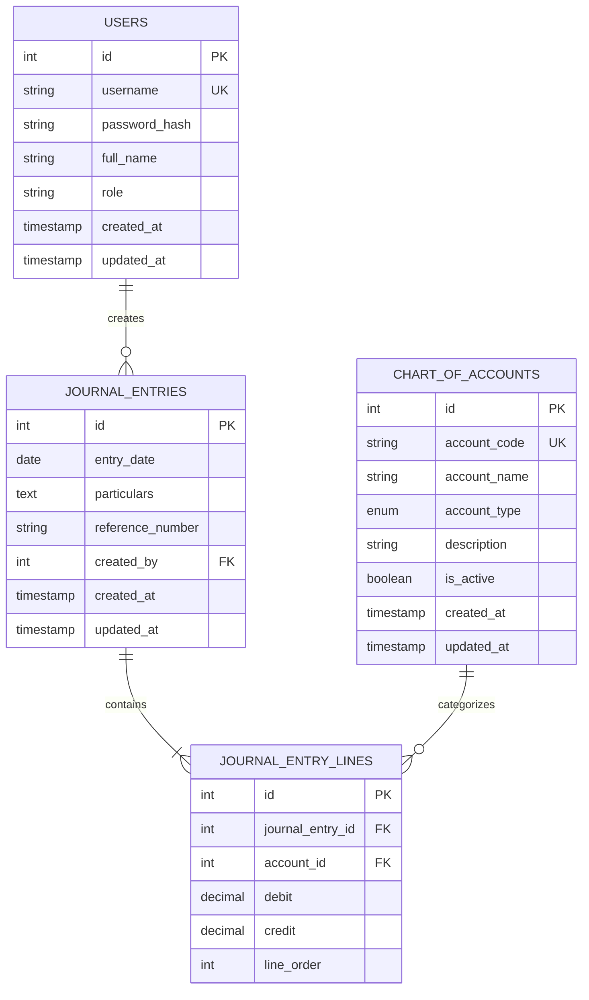
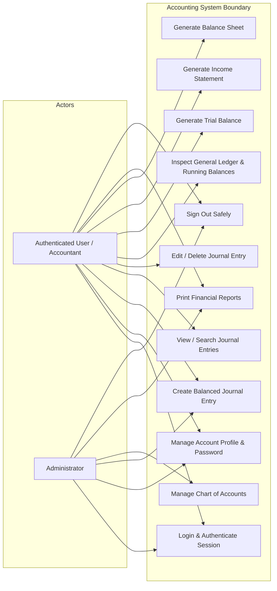
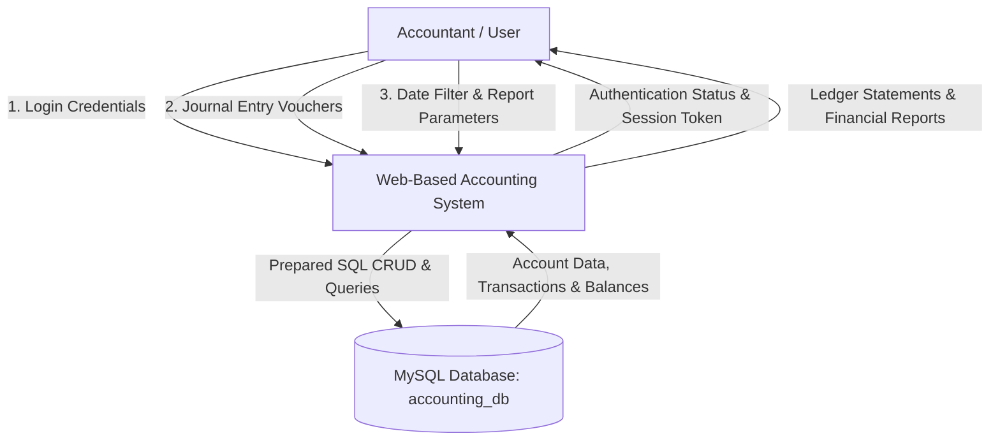
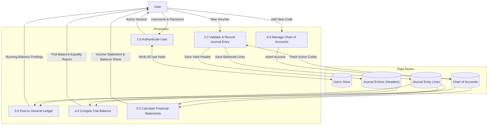
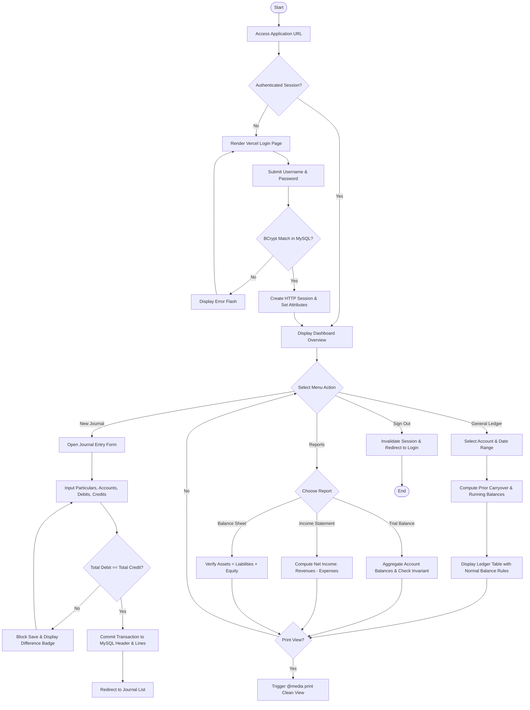
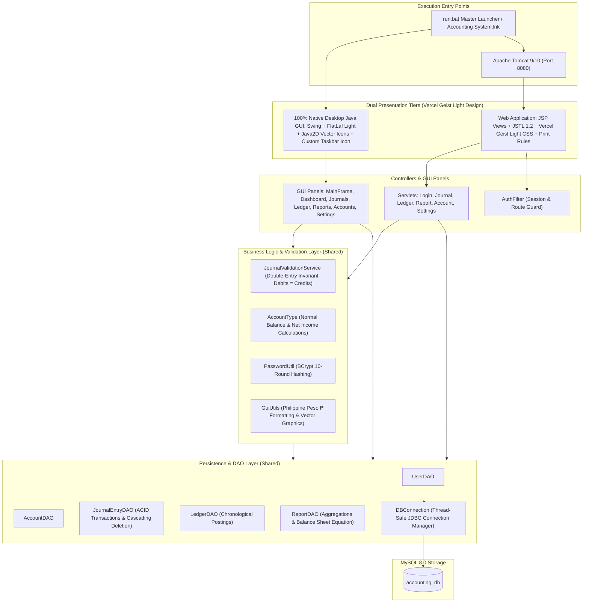

# Accounting System — System Architecture & Design Diagrams

This document contains visual diagrams for the team's final documentation deliverables:
1. Entity Relationship Diagram (ERD)
2. Use Case Diagram
3. Data Flow Diagram (DFD Level 0 & Level 1)
4. System Flowchart (End-to-End Transaction Flow)
5. Clean Architecture Component Diagram

---

## 1. Entity Relationship Diagram (ERD)

---

## 2. Use Case Diagram

---

## 3. Data Flow Diagram (DFD Level 0 Context & Level 1)

### 3.1 DFD Level 0 — Context Diagram

### 3.2 DFD Level 1 — Detailed Process Breakdown

---

## 4. System Flowchart (End-to-End Processing Flow)

---

## 5. Dual-Tier Clean Architecture Component Breakdown

